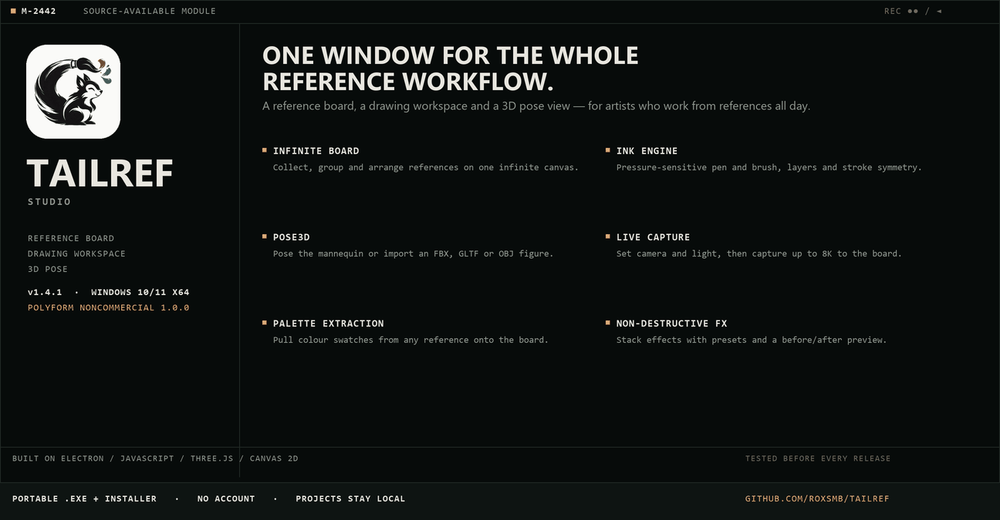
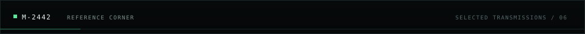
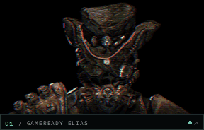
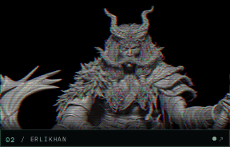
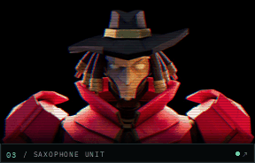

# Emre Melik Nameli (ROXSMB) — 3D Character Artist & Creative Tool Developer

Independent **3D character artist**, **animator** and **creative tool developer** for game studios and independent artists. I turn concept art into **game-ready characters** and **Unreal Engine** assets with **ZBrush**, **Maya**, **Substance Painter** and **TypeScript** tools like **TailRef Studio**.

**[ArtStation Portfolio](https://www.artstation.com/emremeliknameli)** · **[Work With Me](#work-with-me)** · **[Selected Work](#selected-work)** · **[TailRef Studio](#featured-project-tailref-studio)** · **[itch.io](https://roxsmb.itch.io/)** · **[LinkedIn](https://www.linkedin.com/in/emre-melik-nameli-1026a0224/)**

<div align="center">
  <a href="https://www.artstation.com/emremeliknameli">
    
  </a>
</div>

## Table of Contents

- [About Me](#about-me)
- [What I Do](#what-i-do)
- [Work With Me](#work-with-me)
- [Features](#features)
- [Featured Project: TailRef Studio](#featured-project-tailref-studio)
- [Selected Work](#selected-work)
- [3D Art Tools & Technical Skills](#3d-art-tools--technical-skills)
- [How to Build a Game-Ready 3D Character with ZBrush and Unreal Engine](#how-to-build-a-game-ready-3d-character-with-zbrush-and-unreal-engine)
- [Repository Structure](#repository-structure)
- [Installation & Local Preview](#installation--local-preview)
- [Usage](#usage)
- [FAQ](#faq)
- [Connect](#connect)

## About Me

I am **Emre Melik Nameli** — also known as **ROXSMB**, **Roxsmb** or **Roxs.mb** — an independent **3D character artist**, **game artist**, **animator** and **creative tool developer**. I help game studios, indie teams and independent artists turn concept art into **stylized and semi-realistic 3D characters**, **game-ready assets** and **Unreal Engine**-ready builds.

My **3D character art portfolio** covers the full character pipeline: **high-poly sculpting in ZBrush**, **retopology and UV layout in Autodesk Maya**, **PBR texturing in Substance Painter**, **rigging**, **walk-cycle animation** and **real-time validation in Unreal Engine**. I also build artist-first software such as **TailRef Studio**, a local-first reference board made with **Electron**, **TypeScript**, **three.js** and **Canvas 2D**.

The goal is always the same: clean silhouettes, predictable topology, readable materials and tools that remove friction between an idea and a shippable asset.

| Field | Detail |
| --- | --- |
| **Name** | Emre Melik Nameli (ROXSMB / Roxsmb / Roxs.mb) |
| **Role** | Independent 3D Character Artist, Game Artist & Creative Tool Developer |
| **Focus** | Stylized and semi-realistic game characters, animation, artist tooling |
| **Pipeline** | ZBrush → Autodesk Maya → Substance Painter → Unreal Engine |
| **Flagship tool** | TailRef Studio (Electron, TypeScript, three.js, Canvas 2D) |
| **Portfolio & games** | [ArtStation](https://www.artstation.com/emremeliknameli) · [itch.io](https://roxsmb.itch.io/) |
| **Professional & social** | [LinkedIn](https://www.linkedin.com/in/emre-melik-nameli-1026a0224/) · [Reddit](https://www.reddit.com/user/Roxsmb/) |

<div align="center">
  
</div>

## What I Do

### 3D Character Art
High-poly sculpting, **3D modeling**, stylized and semi-realistic character design, likeness and costume detail in **ZBrush**, followed by clean retopology and UV layout in **Autodesk Maya**.

### Game-Ready Assets & Animation
Production meshes with sensible poly budgets, PBR texture sets in **Substance Painter**, rigging, walk cycles and engine-ready exports for **Unreal Engine**.

### Creative Tools for Artists
Desktop and web tools that support the reference-to-render workflow: **Electron** applications, **TypeScript** architecture, **three.js** 3D views and **Canvas 2D** drawing engines.

Whether the deliverable is a hero character or a tool that speeds up the next ten characters, the goal is the same: remove friction between an idea and a shippable asset.

## Work With Me

Looking to hire a **freelance 3D character artist** for a game, cinematic or interactive project? I take on character art, game-ready asset production and creative tool collaborations for studios and independent teams.

| Service | What you get | Ideal for |
| --- | --- | --- |
| **Game-ready character art** | High-poly sculpt, optimized game mesh, UVs, PBR textures and an engine-ready export. | Indie games, prototypes and character select screens. |
| **Stylized character design** | Silhouette exploration, costume and prop detail, presentation renders and breakdowns. | Game studios, animation teams and collectible art. |
| **Animation-ready assets** | Rigging, walk cycles, pose studies and deformation checks for real-time use. | Character pipelines and interactive projects. |
| **Creative tool development** | **Electron** and **TypeScript** desktop tools, **three.js** viewers and **Canvas 2D** drawing interfaces. | Art teams that need custom workflow tools. |

Have a brief or a character in mind? **[Send a message on ArtStation](https://www.artstation.com/emremeliknameli)** or **[connect on LinkedIn](https://www.linkedin.com/in/emre-melik-nameli-1026a0224/)**.

## Features

This repository is a **zero-dependency GitHub Profile README** and portfolio surface. It ships as static Markdown plus optimized SVG/GIF artwork, so there is nothing to build and nothing to install.

| Feature | What it does |
| --- | --- |
| **Animated CRT boot sequence** | A 960×540, 296-frame terminal intro that establishes the M-2442 identity before the portfolio content loads. |
| **Animated identity card** | A responsive SVG personnel file built with pure CSS/SVG animation; it respects `prefers-reduced-motion`. |
| **TailRef Studio showcase** | A product panel that explains the reference board, drawing layer and Pose3D workflow in one glance. |
| **Curated 3D gallery** | Three ArtStation-linked character and environment pieces with descriptive, crawlable alt text. |
| **Search-ready structure** | One H1, semantic H2/H3 headings, a complete table of contents, keyword-rich asset names and natural internal links. |
| **Entity-ready profile** | Consistent name variants (Emre Melik Nameli, ROXSMB, Roxsmb, Roxs.mb), role and profile links across the page. |
| **No build step** | No `package.json`, `requirements.txt`, bundler or runtime dependency. GitHub renders the Markdown directly. |

## Featured Project: TailRef Studio

**TailRef Studio** is my flagship creative tool: a portable Windows desktop app that puts a reference board, a drawing layer and a **Pose3D** view in one window. It is built for artists who work from references all day and do not want to bounce between a browser, an image viewer and a 3D posing tool.

<div align="center">
  
</div>

| Capability | Detail |
| --- | --- |
| **Infinite reference board** | Collect, arrange and compare references on a board that grows with the project. |
| **Drawing layer** | Stack, lock and reorder layers; mirror strokes on both axes with symmetry. |
| **Pose3D view** | A **three.js**-powered 3D pose reference beside the board, without leaving the app. |
| **Built-in research panels** | **Pinterest** and **ArtStation** panels keep new references one drag away. |
| **Wide-gamut color** | A palette wheel with wide-gamut color checks for accurate swatches. |
| **`.tail` board files** | Atomic saves in a versioned board format protect long reference sessions. |
| **Local-first by design** | Portable `.exe`, no installer, no account; boards stay on your machine. |
| **Release status** | v1.4.0, Windows x64, portable `.exe`, MIT; the public source release is not on GitHub yet. |
| **Engineering** | **Electron**, **TypeScript**, **three.js**, **Canvas 2D**; 33 quality gates. |

TailRef Studio currently ships as a portable Windows build. A GitHub link will be added here when the source is public. For a build preview, early access or tool feedback, message me on **[ArtStation](https://www.artstation.com/emremeliknameli)** or **[LinkedIn](https://www.linkedin.com/in/emre-melik-nameli-1026a0224/)**.

## Selected Work

Three recent pieces from my **3D character art portfolio** on **[ArtStation](https://www.artstation.com/emremeliknameli)**. Each preview links to the full project, breakdown and turntable.

<div align="center">
  
</div>

<div align="center">
  <a href="https://www.artstation.com/artwork/eRE9qX"></a>&nbsp;
  <a href="https://www.artstation.com/artwork/AZOnny"></a>&nbsp;
  <a href="https://www.artstation.com/artwork/YGkZnq"></a>
</div>

### [Elias — Game-Ready Character & Walk Cycle](https://www.artstation.com/artwork/eRE9qX)
A stylized game-ready character with a full walk cycle study, built for real-time presentation and animation review.

### [Erlikhan — Character & Industrial City](https://www.artstation.com/artwork/AZOnny)
Character work staged in a dense industrial environment, with a focus on atmosphere, scale and environmental storytelling.

### [The Junk Collector — Stylized Robot Character](https://www.artstation.com/artwork/YGkZnq)
A playful robot design with hard-surface details, a strong silhouette and a worn, hand-built finish.

**Need a character like these for your project? [Start a conversation on ArtStation →](https://www.artstation.com/emremeliknameli)**

## 3D Art Tools & Technical Skills

| Discipline | Tools and technologies |
| --- | --- |
| **3D sculpting** | **ZBrush** |
| **Modeling, retopology and rigging** | **Autodesk Maya** |
| **PBR texturing** | **Substance Painter** |
| **Real-time engine** | **Unreal Engine** |
| **Creative app development** | **Electron**, **TypeScript**, **three.js**, **Canvas 2D** |
| **Asset automation** | **Python** (off-repository scripts that generate the animated artwork) |

My workflow is engine-aware: I keep topology, texel density, material setup and animation constraints in mind from the first blockout, so the final asset does not need a rescue pass in **Unreal Engine**. That same discipline applies to **TailRef Studio**, where board files, layers and local storage are designed to survive real production sessions.

## How to Build a Game-Ready 3D Character with ZBrush and Unreal Engine

This is the high-level pipeline I use to take a character from concept to a real-time build. The steps map to **ZBrush**, **Autodesk Maya**, **Substance Painter** and **Unreal Engine**, but the principles apply to most modern game-art workflows.

### 1. Block out the silhouette and proportions
Start with the largest shapes: height, gesture, costume volumes and the read of the silhouette at a distance. A character that reads at 200 px will read in-game; a character that only works in a close-up will not.

### 2. Sculpt high-frequency detail in ZBrush
Build secondary forms, hard-surface panels, cloth folds and surface detail. Keep the subdivision levels organized so you can return to the base mesh when the design changes.

### 3. Retopologize and UV in Autodesk Maya
Create deformation-friendly topology for the face, shoulders, elbows, hips and knees. Keep the UV layout non-overlapping, evenly packed and sized around the areas the player will actually see.

### 4. Bake and texture in Substance Painter
Bake normal, ambient occlusion and curvature maps from the high-poly mesh, then build a PBR material with consistent roughness and metalness values. Name every texture set so it can be found and reused later.

### 5. Rig, animate and export
Add a skeleton that supports the intended motion, test a walk cycle and export with a predictable scale, pivot and forward axis. Validate the export in a clean scene before importing it into **Unreal Engine**.

### 6. Validate the asset in Unreal Engine
Check the material instances, texture compression, LODs, shadow behavior and performance budget in the engine. The asset is finished when it behaves correctly in context, not when it looks good in the sculpting app.

### Production checklist

```text
[ ] Silhouette reads at 200 px
[ ] Topology supports deformation
[ ] UVs are non-overlapping and evenly packed
[ ] PBR maps share a consistent naming scheme
[ ] Pivot, scale and forward axis match the engine
[ ] LODs and material slots are budgeted
[ ] Asset is reviewed inside Unreal Engine
```

## Repository Structure

```text
.
├── README.md
└── assets/
    ├── 3d-character-art-portfolio-gallery.svg
    ├── 3d-character-artist-boot-sequence.gif
    ├── emre-melik-nameli-3d-artist-profile.svg
    ├── gameready-3d-character-walk-cycle.gif
    ├── industrial-city-3d-environment.gif
    ├── robot-character-3d-modeling.gif
    └── tailref-studio-reference-board-demo.gif
```

| Path | Type | Purpose |
| --- | --- | --- |
| `README.md` | Markdown | Profile landing page, portfolio content and SEO structure. |
| `assets/3d-character-artist-boot-sequence.gif` | GIF, 960×540, 296 frames | Animated CRT boot sequence and hero visual. |
| `assets/emre-melik-nameli-3d-artist-profile.svg` | SVG, 960×400 | Animated personnel/identity card. |
| `assets/tailref-studio-reference-board-demo.gif` | GIF, 1296×675 | TailRef Studio product showcase. |
| `assets/3d-character-art-portfolio-gallery.svg` | SVG, 960×56 | Gallery section banner. |
| `assets/gameready-3d-character-walk-cycle.gif` | GIF, 288×184 | Elias character and walk-cycle preview. |
| `assets/industrial-city-3d-environment.gif` | GIF, 288×184 | Erlikhan industrial city preview. |
| `assets/robot-character-3d-modeling.gif` | GIF, 288×184 | The Junk Collector character preview. |

**Dependency note:** There is no `package.json`, `requirements.txt`, bundler, framework or runtime dependency. This is a static **GitHub Profile README**; GitHub renders the Markdown and serves the assets directly.

## Installation & Local Preview

No build step is required. Clone the repository and open the README in a Markdown previewer:

```bash
git clone https://github.com/Roxsmb/Roxsmb.git
cd Roxsmb

# VS Code: press Ctrl+Shift+V on Windows/Linux or Cmd+Shift+V on macOS
code README.md
```

To verify that every asset path resolves, serve the folder locally:

```bash
python -m http.server 8000

# Windows alternative if `python` is not on PATH:
# py -m http.server 8000

# Open http://localhost:8000/assets/3d-character-artist-boot-sequence.gif
```

The repository has no `npm install`, `pip install` or compile step.

## Usage

### Update the hero visual

Replace the GIF and keep the same descriptive alt text:

```markdown
<div align="center">
  
</div>
```

### Add a new portfolio piece

Copy this block, replace the ArtStation URL, GIF path and character name:

```markdown
<a href="https://www.artstation.com/artwork/YOUR-ARTWORK-ID">
  
</a>
```

### Keep the page fast and indexable

- Export thumbnails at 288×184 and keep each GIF under roughly 300 KB.
- Write alt text that names the character, the asset type and the artist — not a list of keywords.
- Keep one H1 and use H2/H3 for structure; add every new H2 to the table of contents.
- Link each preview to a real ArtStation project so search engines and visitors can follow the work.

## FAQ

### Who is Emre Melik Nameli (ROXSMB)?
**Emre Melik Nameli** — also known as **ROXSMB** and **Roxsmb** — is an independent **3D character artist**, animator and creative tool developer. His work covers game-ready characters, PBR texturing, animation studies and artist-first software.

### Where can I find Emre Melik Nameli online?
The main portfolio is on **[ArtStation](https://www.artstation.com/emremeliknameli)**, games and experiments are on **[itch.io](https://roxsmb.itch.io/)**, professional updates are on **[LinkedIn](https://www.linkedin.com/in/emre-melik-nameli-1026a0224/)**, and code, tools and this profile live on **[GitHub](https://github.com/Roxsmb)**. I also post as **Roxsmb** on **[Reddit](https://www.reddit.com/user/Roxsmb/)**.

### What is TailRef Studio?
**TailRef Studio** is a local-first desktop reference board for artists. It combines an infinite board, a drawing layer and a **Pose3D** view, with built-in **Pinterest** and **ArtStation** panels. It is built with **Electron**, **TypeScript**, **three.js** and **Canvas 2D**.

### What is a game-ready 3D character?
A **game-ready 3D character** is a production asset with optimized topology, clean UVs, PBR textures, a game skeleton and engine-tested scale and material setup. It is ready to drop into a real-time project instead of being a sculpt-only presentation mesh.

### Which 3D software do you use?
The core pipeline is **ZBrush** for sculpting, **Autodesk Maya** for modeling, retopology and rigging, **Substance Painter** for PBR texturing and **Unreal Engine** for real-time validation and presentation.

### Do you work with stylized or semi-realistic characters?
Both. I build **stylized 3D characters** with clear silhouettes and **semi-realistic characters** with detailed PBR materials, depending on the art direction.

### Can you rig and animate characters for Unreal Engine?
Yes. The pipeline includes **rigging**, **walk cycles**, **pose studies** and **Unreal Engine**-ready exports. Final scope depends on the character and the animation set.

### Is TailRef Studio available now?
**TailRef Studio v1.4.0** is a portable Windows x64 build. The public GitHub source release is not available yet; contact me on **[ArtStation](https://www.artstation.com/emremeliknameli)** or **[LinkedIn](https://www.linkedin.com/in/emre-melik-nameli-1026a0224/)** for a build preview or early access.

### Is this repository a software package?
No. This is the `Roxsmb/Roxsmb` **GitHub Profile README** repository. It contains Markdown and image assets only — no `package.json`, `requirements.txt` or application code.

### How can I contact you or start a project?
For commissions, collaborations and tool feedback, message me on **[ArtStation](https://www.artstation.com/emremeliknameli)** or connect with me on **[LinkedIn](https://www.linkedin.com/in/emre-melik-nameli-1026a0224/)**. You can also support the work through **[Buy Me a Coffee](https://buymeacoffee.com/roxsmb)**.

## Connect

Let's build something that looks good and ships clean.

- **ArtStation:** [artstation.com/emremeliknameli](https://www.artstation.com/emremeliknameli)
- **itch.io:** [roxsmb.itch.io](https://roxsmb.itch.io/)
- **LinkedIn:** [linkedin.com/in/emre-melik-nameli-1026a0224](https://www.linkedin.com/in/emre-melik-nameli-1026a0224/)
- **GitHub:** [github.com/Roxsmb](https://github.com/Roxsmb)
- **Reddit:** [reddit.com/user/Roxsmb](https://www.reddit.com/user/Roxsmb/)
- **Buy Me a Coffee:** [buymeacoffee.com/roxsmb](https://buymeacoffee.com/roxsmb)

For **3D character art**, game-ready asset production, animation studies or creative tool collaborations, send a message on ArtStation or LinkedIn.

---

**[↑ Back to top](#emre-melik-nameli-roxsmb--3d-character-artist--creative-tool-developer)**

<sub>Last updated: November 2026 · M-2442 // PROFILE TERMINAL · © Emre Melik Nameli (ROXSMB). Artwork, branding and written content are original. Please do not reuse without permission.</sub>

<!--
  M-2442 // PROFILE TERMINAL
  Animated artwork is generated with an off-repository Python pipeline.
-->
